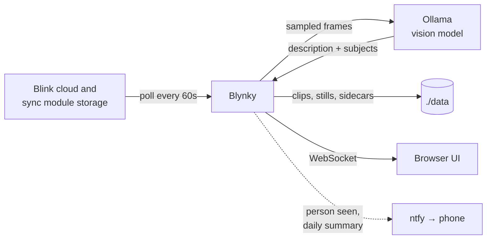

<p align="center">
  
</p>

<h1 align="center">Blynky</h1>

<p align="center">
  <strong>A self-hosted live view and searchable archive for Blink cameras,<br>
  with every motion clip described by a vision model you run yourself.</strong>
</p>

<p align="center">
  <a href="LICENSE"></a>
  
  
  
</p>

---

Blynky shows the latest picture from each of your Blink cameras in a grid. When a camera sees motion, Blynky:

1. switches to that camera
2. plays the clip
3. shows a one-line description of what happened, such as *"A delivery driver leaves a package on the step and walks back to a white van"*

It keeps every clip and still on your own disk, so you can search and filter the whole history. It can also send alerts to your phone, but only when it matters: by default, only when a person shows up.

It runs on your own machine, and the descriptions come from a model on your own [Ollama](https://ollama.com) server. Blynky talks to Blink through [blinkpy](https://github.com/fronzbot/blinkpy). It doesn't need a Blink subscription: it can read clips straight from a sync module's USB storage.

## Features

- **Live camera grid.** Each card shows the camera's newest picture, its age, the last thing it saw, and *Disarmed* or *Offline* when that applies. You can take a fresh photo with one camera on demand.
- **Motion clips with descriptions.** Blynky samples frames from each clip and has a vision model describe them. Each description also lists what it found (`person`, `animal`, `vehicle` or `package`), and that list drives the filters and alerts. Captures are tagged too: `#person`, `#vehicle`, `#night`, a few finer tags like `#dog` or `#delivery`, and the names of people it recognises (or `#unknown` when it doesn't).
- **A full library.** Every clip and still is saved, grouped by day and searchable by text or `#tag`. You can filter by camera or by what was seen, and jump to any date. Star the captures worth keeping, and show only those with one click.
- **Phone alerts through [ntfy](https://ntfy.sh).** An alert carries the description and a frame from the clip, and tapping it can open that capture in Blynky. You choose which subjects trigger one, there's a cooldown for each camera, and you can pause alerts from the UI.
- **Daily summaries (optional).** Once a day is over, the model reads that day's descriptions and writes a two- or three-sentence summary of it: for each camera, for each location (Blink system), for all cameras together, or any mix of those. Summaries appear on each camera's page and at the top of each day in the library, and can be pushed to ntfy each night. Past days can be summarized one at a time or all at once, with a warning about token use first.
- **Known people (optional).** Tag a person in a few captures and the model will guess who later visitors are ("Looks like Alex"). Recognised people can get quieter alerts, or none at all.
- **Catches what polling misses.** **Sync now** pulls recent clips from the cloud and from the sync modules' storage, including clips recorded while Blynky wasn't running.
- **Copes with Blink changes.** Cameras renamed, re-added or moved between systems are picked up without a restart, and their history stays with them.
- **Works well as a wall display or phone app.** It has light and dark themes, keyboard shortcuts, an optional chime, desktop alerts and a keep-awake mode, and you can add it to a phone's home screen.
- **Optional retention.** It can delete captures by age, with a dry-run mode to check first. Starred captures are never deleted.

## How it works



Blink has no push API, so Blynky polls, no more often than once a minute so it doesn't overload Blink's servers. Expect motion to show up tens of seconds after it happens, because the clip has to finish uploading to Blink first.

## Quick start (Docker)

You need Docker with Compose, and an Ollama server with a vision model that is reachable from the container. The image takes care of everything else, including `ffmpeg` and blinkpy. It is published on GitHub's registry as `ghcr.io/gudlyf/blynky`, for amd64 and arm64 (Apple Silicon, Raspberry Pi 4 and 5).

```bash
git clone https://github.com/gudlyf/blynky.git
cd blynky
cp .env.example .env     # at least set OLLAMA_URL and OLLAMA_MODEL
docker compose up -d     # pulls the image
```

Open <http://127.0.0.1:8080> and sign in with your Blink email and password, plus a 2FA code if Blink asks for one. Polling starts right away, without a restart. The session token is saved in `data/`, so you won't be asked again after a restart.

> [!TIP]
> When Ollama runs on the same machine as Docker, set `OLLAMA_URL=http://host.docker.internal:11434/v1`. Ollama also has to be listening on more than loopback (`OLLAMA_HOST=0.0.0.0:11434`), otherwise the container gets "connection refused". For details, see [Reaching Ollama from the container](docs/guide.md#reaching-ollama-from-the-container).

## Running without Docker

You need Python 3.10+, [uv](https://docs.astral.sh/uv/), and `ffmpeg`/`ffprobe` on your `PATH`.

Blynky pins a blinkpy commit because the pinned commit includes fixes that are not yet in any released blinkpy version. `pyproject.toml` therefore expects a blinkpy checkout next to this repo, pinned to the same commit the Docker image uses:

```bash
git clone https://github.com/gudlyf/blinkpy.git ../blinkpy
git -C ../blinkpy checkout "$(sed -n 's/^ARG BLINKPY_REF=//p' Dockerfile)"

cp .env.example .env
uv run run.py
```

That commit is on the `blynky` branch of [gudlyf/blinkpy](https://github.com/gudlyf/blinkpy), which carries Blynky's own blinkpy fixes; see the [guide](docs/guide.md#where-blinkpy-comes-from).

## Security

> [!WARNING]
> **Blynky has no login of its own.** Anyone who can reach the port can see your cameras, clips and descriptions.

For that reason it listens on `127.0.0.1` by default. To reach it from your other devices, the best option is to put it behind something that adds HTTPS and limits who can connect, such as [`tailscale serve`](https://tailscale.com/kb/1312/serve). Best is as a [Tailscale Service](https://tailscale.com/blog/services-beta), which gives Blynky a name of its own, `https://blynky.your-tailnet.ts.net`. Define `blynky` under Services in the admin console, listening on TCP 443, then on this machine (which must carry a tag):

```bash
tailscale serve --service=svc:blynky --https=443 127.0.0.1:8080
```

and approve the machine as the service's host. Without Services, `tailscale serve --bg --https=443 8080` puts it on the machine's own name instead.

Never expose it to the open internet, for example with `tailscale funnel` or a port forward. [Reaching it from other devices](docs/guide.md#reaching-it-from-other-devices) compares the options.

Keep these in mind too:

- **The credentials file.** `.blink_creds.json` holds your Blink password in plain text next to the tokens, because blinkpy stores it that way. Blynky makes it readable only by you (`chmod 600`), and `.gitignore` and `.dockerignore` both exclude it.
- **ntfy topics are public.** Anyone who knows the name of an ntfy.sh topic can read it, and these alerts say who is at your door and when. With **Send to ntfy** on, so does a summary of each camera's day. Use a long, random topic name or a self-hosted ntfy server.
- **Notification links (`BLYNKY_URL`).** Setting `BLYNKY_URL` makes a notification open the capture when tapped. Use an address only your own devices can reach, such as your `tailscale serve` name or a LAN address, and never one open to the internet: the link goes to a server with no login. It only works where your phone can reach that address, so a LAN address won't open while you're away. The address is also sent inside every notification, so anyone who can read the topic sees it.

## Configuration

Every setting is an environment variable, and all of them are optional. Put them in `.env` (start from [`.env.example`](.env.example)) or set them in the shell. A value already set in the environment beats the one in `.env`.

**Under Docker,** `docker-compose.yml` fixes `HOST`, `PORT`, `DATA_DIR` and `CREDFILE`. To choose which host address the port is published on, use `BIND_ADDR` and `HOST_PORT` (default `127.0.0.1:8080`) instead. `BLYNKY_TAG` picks which published image it pulls, `latest` by default; see [The published image](docs/guide.md#the-published-image) for the tags and how to upgrade.

<details open>
<summary><strong>Core</strong></summary>

| Variable | Default | Meaning |
| --- | --- | --- |
| `VISION_PROVIDER` | `ollama` | Vision provider: `ollama` or `gemini` |
| `OLLAMA_URL` | `http://localhost:11434/v1` | OpenAI-compatible Ollama endpoint |
| `OLLAMA_MODEL` | `minimax-m3:cloud` | Vision model for Ollama; any vision-capable model works |
| `PROVIDER_PAUSE` | `0` | Minimum seconds between requests to vision provider |
| `GEMINI_API_KEY` | unset | Google Gemini API key |
| `GEMINI_MODEL` | `gemini-3.5-flash-lite` | Gemini model name |
| `GEMINI_URL` | `https://generativelanguage.googleapis.com/v1beta/openai` | Gemini OpenAI-compatible base URL |
| `GEMINI_PAUSE` | unset | Overrides `PROVIDER_PAUSE` when `VISION_PROVIDER` is `gemini` (e.g. `4.5` to avoid RPM rate limits) |
| `HOST` / `PORT` | `127.0.0.1` / `8080` | Where the UI listens |
| `POLL_SECONDS` | `60` | Seconds between Blink polls (minimum 60) |
| `DATA_DIR` | `./data` | Where clips, stills and state are written |
| `CREDFILE` | `./.blink_creds.json` | Where the Blink session token is saved |

</details>

<details>
<summary><strong>Describing clips</strong></summary>

| Variable | Default | Meaning |
| --- | --- | --- |
| `MAX_FRAMES` | `4` | Frames sampled per clip |
| `MAX_TOKENS` | `1500` | Model output budget. Reasoning models need room to think, and too small a budget returns an empty answer |
| `VISION_TIMEOUT` | `180` | Seconds before giving up on the model |
| `VISION_MAX_RETRIES` | `4` | Max retries with exponential backoff on 429/503 responses |
| `VISION_RETRY_DELAY` | `5.0` | Base delay in seconds for exponential backoff |
| `CATCH_UP` | unset | `1` describes events already on the server at start-up |
| `BACKFILL` | `1` | At start-up, describe saved clips that have no description |
| `BACKFILL_PAUSE` | `2` | Seconds between clips while working through that backlog |
| `DESCRIBE_ATTEMPTS` | `3` | Give up on a clip after this many failed attempts |

</details>

<details>
<summary><strong>Daily summaries</strong></summary>

| Variable | Default | Meaning |
| --- | --- | --- |
| `DAILY_SUMMARIES` | unset | `1` turns on a short summary of each camera's day. The switch in the settings menu overrides this once used. See the [guide](docs/guide.md#daily-summaries) |
| `DAILY_SCOPES` | `camera` | What gets a summary: any of `camera`, `location` (each Blink system, its cameras together) and `all` (every camera together), comma separated. The settings menu overrides this once used |
| `DAILY_HOUR` | `1` | Hour, server time, after which yesterday is summarized |
| `DAILY_MAX_CLIPS` | `300` | Most clip descriptions one day's summary is written from |
| `DAILY_PAUSE` | `2` | Seconds between days while backfilling summaries |
| `TZ` | UTC in Docker | Time zone the days are split in, such as `America/New_York`. Set it, or under Docker each day ends at midnight UTC |

</details>

<details>
<summary><strong>Notifications and known people</strong></summary>

| Variable | Default | Meaning |
| --- | --- | --- |
| `NTFY_URL` | unset | ntfy topic URL. Nothing is sent while this is empty |
| `NTFY_PUBLIC_URL` | unset | Only for the optional ntfy server in `docker-compose.yml` (`--profile ntfy`): where your phone reaches it. See [Running your own ntfy server](docs/guide.md#running-your-own-ntfy-server) |
| `NTFY_SYSTEM_TOPICS` | as `SYSTEM_PREFIX` | `1` sends each Blink system's notifications to its own topic, `<system>-<topic>` beside `NTFY_URL`'s. See the [guide](docs/guide.md#notifications) |
| `NTFY_SUBJECTS` | `person` | Subjects that trigger an alert: `person`, `animal`, `vehicle`, `package` |
| `NTFY_PRIORITY` | `4` | ntfy priority, from 1 (min) to 5 (max) |
| `NTFY_COOLDOWN` | `120` | Seconds before the same camera may alert again |
| `NTFY_TIMEOUT` | `15` | Seconds before giving up on reaching the ntfy server |
| `BLYNKY_URL` | unset | Address your phone reaches Blynky at, such as `https://blynky.your-tailnet.ts.net`. When set, tapping a notification opens that capture. See [Security](#security) |
| `IDENTIFY` | `1` | Guess who a person is, once people have been tagged |
| `IDENTIFY_MIN_CONFIDENCE` | `high` | Least confidence that counts as a match (`low`, `medium`, `high`) |
| `MAX_REFERENCES` | `5` | Reference frames kept per person |
| `IDENTIFY_MAX_IMAGES` | `12` | Reference frames sent in one identification |
| `IDENTIFY_TIMEOUT` | `240` | Seconds before giving up on an identification |
| `NTFY_KNOWN_PRIORITY` | `2` | Priority when everyone seen is recognised |
| `NTFY_SKIP_KNOWN` | `0` | `1` sends nothing when everyone seen is recognised |
| `NTFY_DAILY` | unset | `1` pushes each night's daily summaries to ntfy. The **Send to ntfy** switch in the settings menu overrides this once used |
| `NTFY_DAILY_PRIORITY` | `2` | ntfy priority for those summaries. Low, so they arrive without a sound |

</details>

<details>
<summary><strong>UI, sync and retention</strong></summary>

| Variable | Default | Meaning |
| --- | --- | --- |
| `HISTORY` | `50` | Recent events sent to a page when it loads |
| `PAGE_SIZE` | `60` | Captures per page in the library |
| `TIMELINE` | `25` | Rows in the motion timeline |
| `SYNC_LIMIT` | `5` | Clips per camera that **Sync now** pulls |
| `SYNC_DAYS` | `2` | How many days back **Sync now** searches Blink's cloud clips |
| `SYSTEM_PREFIX` | unset | `1` names each camera `System:Camera`, for accounts with more than one Blink system, where two cameras can share a name. See [Two cameras with the same name](docs/guide.md#two-cameras-with-the-same-name) |
| `CAMERA_RENAMES` | empty | `Old Name=New Name` pairs, comma-separated. See [Renaming a camera](docs/guide.md#renaming-a-camera) |
| `RETAIN_DAYS` | `0` | Delete captures older than this, except starred ones. `0` keeps everything |
| `RETAIN_DRY_RUN` | `0` | `1` logs what retention would delete, without deleting it |

</details>

## Where your data goes

Everything is written under `DATA_DIR` as ordinary files. Each capture has a JSON sidecar that describes it, so the archive needs no database and survives restarts and moves.

```
data/
  events/<camera>/<timestamp>.mp4         motion clip
                  <timestamp>.jpg         still
                  <timestamp>-thumb.jpg   480×270 thumbnail
                  <timestamp>.json        sidecar: time, camera, description, subjects, star
  stills/<camera>/<timestamp>.jpg         photos taken on demand
  latest/<camera>.jpg                     the picture each card shows
  people/<person>/                        reference frames for known people
  daily/<camera>/<YYYY-MM-DD>.json        one camera's summary of one day
  daily/_location-<system>/, daily/_all/  the same for a location, or every camera
  cameras.json                            every name each camera has had
  ntfy.json, daily.json                   settings changed from the settings menu
```

`scripts/rename_camera.py` moves a camera's existing archive to its new name. See [Refiling what was already captured](docs/guide.md#refiling-what-was-already-captured).

## Documentation

The **[guide](docs/guide.md)** covers each part in depth:

- the UI and its [keyboard shortcuts](docs/guide.md#keyboard-shortcuts)
- why stills can be [hours or months old](docs/guide.md#how-old-the-stills-are)
- [how identification works](docs/guide.md#known-people), and why it isn't face recognition
- [daily summaries](docs/guide.md#daily-summaries): what is sent to the model, when, and what it costs
- [opening a capture from a notification](docs/guide.md#opening-the-capture-from-a-notification)
- [where Blink keeps a clip](docs/guide.md#where-blink-keeps-a-clip-and-the-sync-now-button) and what **Sync now** recovers
- the [Docker build](docs/guide.md#docker-in-depth) and how blinkpy is pinned

## Contributing

Issues and pull requests are welcome. [CONTRIBUTING.md](CONTRIBUTING.md) covers the development setup and what a change needs. To report a security problem, see [SECURITY.md](SECURITY.md). Don't open a public issue for one.

## License

[MIT](LICENSE) © 2026 Keith McDuffee

---

<sub>Blynky is an independent project. It is not affiliated with, endorsed by or sponsored by Amazon or Blink. "Blink" is a trademark of Amazon.com, Inc. or its affiliates. Blynky relies on Blink's unofficial API through blinkpy, which may change or break without notice.</sub>
