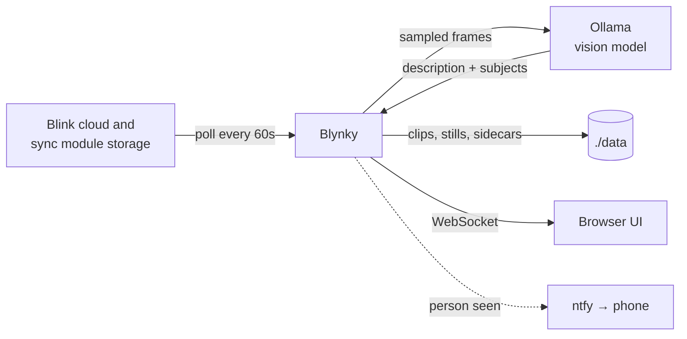

<p align="center">
  
</p>

<h1 align="center">Blynky</h1>

<p align="center">
  <strong>A self-hosted live view and searchable archive for Blink cameras,<br>
  with every motion clip described by a vision model you run yourself.</strong>
</p>

<p align="center">
  <a href="LICENSE"></a>
  
  
  
</p>

---

Blynky shows the latest picture from each of your Blink cameras in a grid. When a camera sees motion, Blynky:

1. switches to that camera
2. plays the clip
3. shows a one-line description of what happened, such as *"A delivery driver leaves a package on the step and walks back to a white van"*

It keeps every clip and still on your own disk, so you can search and filter the whole history. It can also send alerts to your phone, but only when it matters: by default, only when a person shows up.

It runs on your own machine, and the descriptions come from a model on your own [Ollama](https://ollama.com) server. Blynky talks to Blink through [blinkpy](https://github.com/fronzbot/blinkpy). It doesn't need a Blink subscription: it can read clips straight from a sync module's USB storage.

## Features

- **Live camera grid.** Each card shows the camera's newest picture, its age, the last thing it saw, and *Disarmed* or *Offline* when that applies. You can take a fresh photo with one camera on demand.
- **Motion clips with descriptions.** Blynky samples frames from each clip and has a vision model describe them. Each description also lists what it found (`person`, `animal`, `vehicle` or `package`), and that list drives the filters and alerts.
- **A full library.** Every clip and still is saved, grouped by day and searchable by text. You can filter by camera or by what was seen, and jump to any date.
- **Phone alerts through [ntfy](https://ntfy.sh).** An alert carries the description and a frame from the clip. You choose which subjects trigger one, there's a cooldown for each camera, and you can pause alerts from the UI.
- **Known people (optional).** Tag a person in a few captures and the model will guess who later visitors are ("Looks like Alex"). Recognised people can get quieter alerts, or none at all.
- **Catches what polling misses.** **Sync now** pulls recent clips from the cloud and from the sync modules' storage, including clips recorded while Blynky wasn't running.
- **Copes with Blink changes.** Cameras renamed, re-added or moved between systems are picked up without a restart, and their history stays with them.
- **Works well as a wall display or phone app.** It has light and dark themes, keyboard shortcuts, an optional chime, desktop alerts and a keep-awake mode, and you can add it to a phone's home screen.
- **Optional retention.** It can delete captures by age, with a dry-run mode to check first.

## How it works



Blink has no push API, so Blynky polls, no more often than once a minute so it doesn't overload Blink's servers. Expect motion to show up tens of seconds after it happens, because the clip has to finish uploading to Blink first.

## Quick start (Docker)

You need Docker with Compose, and an Ollama server with a vision model that is reachable from the container. Docker takes care of everything else, including `ffmpeg` and blinkpy.

```bash
git clone https://github.com/gudlyf/blynky.git
cd blynky
cp .env.example .env     # at least set OLLAMA_URL and OLLAMA_MODEL
docker compose up -d
```

Open <http://127.0.0.1:8080> and sign in with your Blink email and password, plus a 2FA code if Blink asks for one. Polling starts right away, without a restart. The session token is saved in `data/`, so you won't be asked again after a restart.

> [!TIP]
> When Ollama runs on the same machine as Docker, set `OLLAMA_URL=http://host.docker.internal:11434/v1`. Ollama also has to be listening on more than loopback (`OLLAMA_HOST=0.0.0.0:11434`), otherwise the container gets "connection refused". For details, see [Reaching Ollama from the container](docs/guide.md#reaching-ollama-from-the-container).

## Running without Docker

You need Python 3.10+, [uv](https://docs.astral.sh/uv/), and `ffmpeg`/`ffprobe` on your `PATH`.

Blynky depends on blinkpy's OAuth v2 login, which so far exists only on blinkpy's `dev` branch, not on PyPI. `pyproject.toml` therefore expects a blinkpy checkout next to this repo, pinned to the same commit the Docker image uses and with the same patches applied:

```bash
git clone https://github.com/fronzbot/blinkpy.git ../blinkpy
git -C ../blinkpy checkout 4d0c274f8e20bdf268949eb2d756bf527dc0ae7e
git -C ../blinkpy apply "$PWD"/patches/*.patch

cp .env.example .env
uv run run.py
```

[patches/README.md](patches/README.md) explains what each patch does.

## Security

> [!WARNING]
> **Blynky has no login of its own.** Anyone who can reach the port can see your cameras, clips and descriptions.

For that reason it listens on `127.0.0.1` by default. To reach it from your other devices, the best option is to put it behind something that adds HTTPS and limits who can connect, such as [`tailscale serve`](https://tailscale.com/kb/1312/serve):

```bash
tailscale serve --bg --https=443 8080
```

Never expose it to the open internet, for example with `tailscale funnel` or a port forward. [Reaching it from other devices](docs/guide.md#reaching-it-from-other-devices) compares the options.

Keep two more things in mind:

- **The credentials file.** `.blink_creds.json` holds your Blink password in plain text next to the tokens, because blinkpy stores it that way. Blynky makes it readable only by you (`chmod 600`), and `.gitignore` and `.dockerignore` both exclude it.
- **ntfy topics are public.** Anyone who knows the name of an ntfy.sh topic can read it, and these alerts say who is at your door and when. Use a long, random topic name or a self-hosted ntfy server.

## Configuration

Every setting is an environment variable, and all of them are optional. Put them in `.env` (start from [`.env.example`](.env.example)) or set them in the shell. A value already set in the environment beats the one in `.env`.

**Under Docker,** `docker-compose.yml` fixes `HOST`, `PORT`, `DATA_DIR` and `CREDFILE`. To choose which host address the port is published on, use `BIND_ADDR` and `HOST_PORT` (default `127.0.0.1:8080`) instead.

<details open>
<summary><strong>Core</strong></summary>

| Variable | Default | Meaning |
| --- | --- | --- |
| `OLLAMA_URL` | `http://localhost:11434/v1` | OpenAI-compatible endpoint |
| `OLLAMA_MODEL` | `minimax-m3:cloud` | Vision model; any vision-capable model works |
| `HOST` / `PORT` | `127.0.0.1` / `8080` | Where the UI listens |
| `POLL_SECONDS` | `60` | Seconds between Blink polls (minimum 60) |
| `DATA_DIR` | `./data` | Where clips, stills and state are written |
| `CREDFILE` | `./.blink_creds.json` | Where the Blink session token is saved |

</details>

<details>
<summary><strong>Describing clips</strong></summary>

| Variable | Default | Meaning |
| --- | --- | --- |
| `MAX_FRAMES` | `4` | Frames sampled per clip |
| `MAX_TOKENS` | `1500` | Model output budget. Reasoning models need room to think, and too small a budget returns an empty answer |
| `VISION_TIMEOUT` | `180` | Seconds before giving up on the model |
| `CATCH_UP` | unset | `1` describes events already on the server at start-up |
| `BACKFILL` | `1` | At start-up, describe saved clips that have no description |
| `BACKFILL_PAUSE` | `2` | Seconds between clips while working through that backlog |
| `DESCRIBE_ATTEMPTS` | `3` | Give up on a clip after this many failed attempts |

</details>

<details>
<summary><strong>Notifications and known people</strong></summary>

| Variable | Default | Meaning |
| --- | --- | --- |
| `NTFY_URL` | unset | ntfy topic URL. Nothing is sent while this is empty |
| `NTFY_SUBJECTS` | `person` | Subjects that trigger an alert: `person`, `animal`, `vehicle`, `package` |
| `NTFY_PRIORITY` | `4` | ntfy priority, from 1 (min) to 5 (max) |
| `NTFY_COOLDOWN` | `120` | Seconds before the same camera may alert again |
| `IDENTIFY` | `1` | Guess who a person is, once people have been tagged |
| `IDENTIFY_MIN_CONFIDENCE` | `high` | Least confidence that counts as a match (`low`, `medium`, `high`) |
| `MAX_REFERENCES` | `5` | Reference frames kept per person |
| `IDENTIFY_MAX_IMAGES` | `12` | Reference frames sent in one identification |
| `NTFY_KNOWN_PRIORITY` | `2` | Priority when everyone seen is recognised |
| `NTFY_SKIP_KNOWN` | `0` | `1` sends nothing when everyone seen is recognised |

</details>

<details>
<summary><strong>UI, sync and retention</strong></summary>

| Variable | Default | Meaning |
| --- | --- | --- |
| `HISTORY` | `50` | Recent events sent to a page when it loads |
| `PAGE_SIZE` | `60` | Captures per page in the library |
| `TIMELINE` | `25` | Rows in the motion timeline |
| `SYNC_LIMIT` | `5` | Clips per camera that **Sync now** pulls |
| `SYNC_DAYS` | `2` | How many days back **Sync now** searches Blink's cloud clips |
| `CAMERA_RENAMES` | empty | `Old Name=New Name` pairs, comma-separated. See [Renaming a camera](docs/guide.md#renaming-a-camera) |
| `RETAIN_DAYS` | `0` | Delete captures older than this. `0` keeps everything |
| `RETAIN_DRY_RUN` | `0` | `1` logs what retention would delete, without deleting it |

</details>

## Where your data goes

Everything is written under `DATA_DIR` as ordinary files. Each capture has a JSON sidecar that describes it, so the archive needs no database and survives restarts and moves.

```
data/
  events/<camera>/<timestamp>.mp4         motion clip
                  <timestamp>.jpg         still
                  <timestamp>-thumb.jpg   480×270 thumbnail
                  <timestamp>.json        sidecar: time, camera, description, subjects
  stills/<camera>/<timestamp>.jpg         photos taken on demand
  latest/<camera>.jpg                     the picture each card shows
  people/<person>/                        reference frames for known people
```

`scripts/rename_camera.py` moves a camera's existing archive to its new name. See [Refiling what was already captured](docs/guide.md#refiling-what-was-already-captured).

## Documentation

The **[guide](docs/guide.md)** covers each part in depth:

- the UI and its [keyboard shortcuts](docs/guide.md#keyboard-shortcuts)
- why stills can be [hours or months old](docs/guide.md#how-old-the-stills-are)
- [how identification works](docs/guide.md#known-people), and why it isn't face recognition
- [where Blink keeps a clip](docs/guide.md#where-blink-keeps-a-clip-and-the-sync-now-button) and what **Sync now** recovers
- the [Docker build](docs/guide.md#docker-in-depth) and how blinkpy is pinned

## Contributing

Issues and pull requests are welcome. To lint before sending a change:

```bash
uv run ruff check .
```

If you change blinkpy itself, put the change in `patches/` too, so that `uv run` and the Docker image keep using the same blinkpy.

## License

[MIT](LICENSE) © 2026 Keith McDuffee

---

<sub>Blynky is an independent project. It is not affiliated with, endorsed by or sponsored by Amazon or Blink. "Blink" is a trademark of Amazon.com, Inc. or its affiliates. Blynky relies on Blink's unofficial API through blinkpy, which may change or break without notice.</sub>
